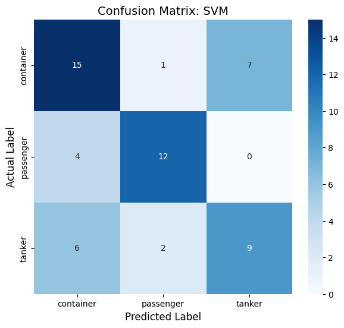
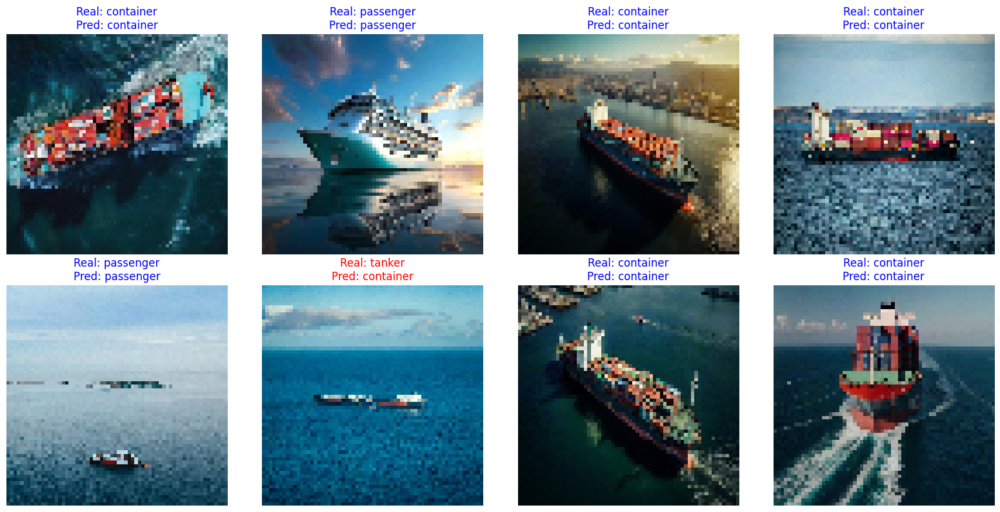

**English** | [한국어](README.ko.md)

# Ship Type Classifier

Classifies ship photos into three types (**container**, **passenger**, **tanker**) with classic scikit-learn models. We compared grayscale and RGB inputs across four algorithms and picked the best combination.

Team project for *Introduction to AI and Practice* (Spring 2026), 5-person team.

All code is in a single notebook: `8조_학습코드 .ipynb`.

## My Role

I collected training images and made the presentation slides. The model code was written by other team members.

## Dataset

- 280 images across 3 classes, collected by the team via Google Image Search
- 80/20 train/test split (test set: 56 images, with 23 container, 16 passenger and 17 tanker)
- The raw images are not included in this repository.

## Preprocessing

A single function, `preprocess_images_advanced()`, walks each class folder and skips files that fail to load.

1. **Resize** to 64×64 with `cv2.resize`
2. **Color conversion**: grayscale (`COLOR_BGR2GRAY`) or RGB (`COLOR_BGR2RGB`, converting from OpenCV's BGR order)
3. **Flatten** to a 1-D vector: 4,096 features (grayscale) / 12,288 features (RGB)
4. **Normalize** to [0, 1] with `MinMaxScaler`

Grayscale keeps shape and silhouette and is cheaper to compute. RGB keeps hull color, paint and cargo color.

## Experiment

2 input formats × 4 models = 8 runs, automated with a nested loop. The outer loop picks a dataset and splits it, and the inner loop runs `fit` → `predict` → `accuracy_score` for each model and stores the result.

| Model | Parameters | Notes |
|---|---|---|
| Random Forest | `n_estimators=100` | Majority vote of decision trees; robust to noise |
| SVM | RBF kernel, `C=10` | Max-margin boundary; strong on high-dimensional data |
| KNN | `n_neighbors=5` | Label of the 5 nearest images |
| Logistic Regression | `max_iter=1000` | Linear model; fast, but limited to linear boundaries |

Shared settings: `TEST_SIZE = 0.2`, `IMG_SIZE = 64`, `RANDOM_SEED = 123123`

## Results

| Model | Grayscale (4,096) | RGB (12,288) |
|---|---|---|
| Random Forest | 53.57% | 53.57% |
| SVM | 58.93% | **64.29%** |
| KNN | 30.36% | 51.79% |
| Logistic Regression | 55.36% | 55.36% |

**RGB + SVM scored highest at 64.29% and was selected as the final model.**

### Analysis

- **When color helped**: KNN jumped from 30.36% to 51.79% (+21 %p) with RGB. Cues like red anti-fouling paint near the waterline or multicolored container stacks get flattened into gray in grayscale.
- **Why RGB + SVM won**: SVM handles the 12,288-dimensional space well, and color gave it clearer boundaries between classes.
- **Why RGB didn't always win**: Random Forest and Logistic Regression scored the same on both inputs. Our explanation:
  - *Dimensionality*: the same 280 images now have 3× the features, which makes overfitting easier.
  - *Color noise*: most of each photo is sea and sky, whose color changes with weather and time of day. Models can latch onto background color instead of the ship. Grayscale removes that noise and leaves shape.

### Final Model (RGB + SVM)

| Class | Precision | Recall | F1 | Support |
|---|---|---|---|---|
| container | 0.60 | 0.65 | 0.62 | 23 |
| passenger | 0.80 | 0.75 | 0.77 | 16 |
| tanker | 0.56 | 0.53 | 0.55 | 17 |
| **Accuracy** | | | **0.64** | 56 |



Passenger ships were the easiest to identify; tankers were confused most often.

### Sample Predictions

Test images reconstructed from the 64×64 input. Blue = correct, red = wrong.



Likely causes of errors:
- Dark, angular hulls mistaken for container ships
- Photos where background dominates the ship
- Fine structural details lost at 64×64

## Future Work

- **Data**: Hundreds of images per class, balanced across angles, weather, time of day and port settings. Alternatively, filter for simple backgrounds with the ship centered.
- **Preprocessing**: Crop the ship with an object detector before training to reduce background influence; raise resolution to 128×128 or more.

## Tech Stack

Python, scikit-learn, OpenCV, NumPy, Matplotlib, Seaborn, Google Colab

## Getting Started

The notebook is written for Google Colab.

1. Put images in Google Drive with this layout:
   ```
   MyDrive/Colab Notebooks/dataset/
   ├── container/
   ├── passenger/
   └── tanker/
   ```
2. Open the notebook in Colab and run the cells top to bottom.
